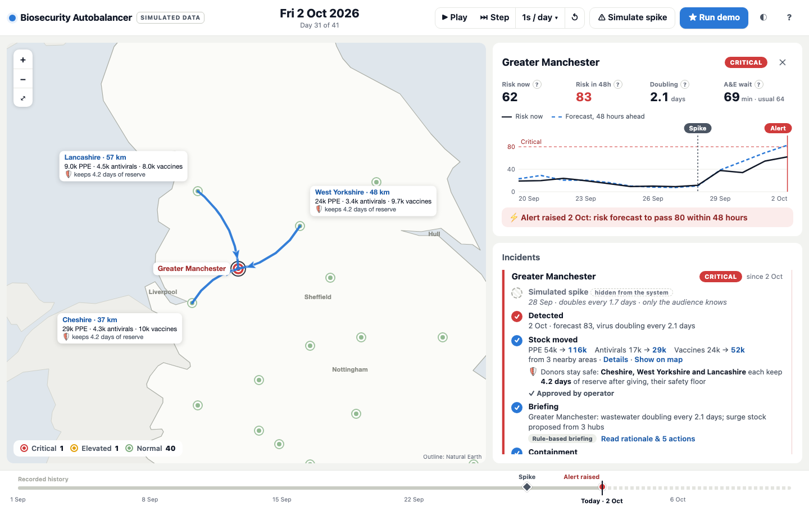
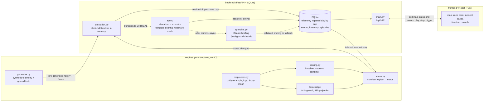

# BioSecure

An early-warning system for disease outbreaks across England's 42 Integrated Care
Boards (ICBs), built as a hackathon demo. It has two halves:

- **Early warning.** It watches wastewater viral load and A&E waiting times, scores
  each area against its own recent baseline, and forecasts the risk score 48 hours
  ahead. When the forecast crosses 80 and the growth is statistically significant, the
  area goes **red**, typically 2 days before today's score would get there.
- **Autobalancer.** It runs as soon as an area goes red. It moves PPE, antivirals and
  vaccines from the nearest areas that are still normal, with no donor going below a
  safety floor. It then writes a briefing and triggers a containment step (a mock
  rideshare webhook).

All quantities are computed deterministically. Claude, when an API key is present, only
writes the plain-English rationale and actions.

> **All data is synthetic.** See the [limitations](docs/MATHS.md#9-limitations-honest).



## Quickstart

You need **Python 3.13** (other 3.10+ versions are untested) and **Node 24** with npm.

```bash
git clone https://github.com/anoopjois/oxhack-biosecurity.git
cd oxhack-biosecurity
cp .env.example .env        # optional: add ANTHROPIC_API_KEY for AI briefings
./dev.sh                    # first run creates .venv and installs npm packages
```

Open http://localhost:5173 and click **★ Run demo**.

`dev.sh` starts FastAPI on `BACKEND_PORT` (8000) and Vite on `FRONTEND_PORT` (5173).
Both come from `.env`, and Ctrl-C stops both. If your default `python3` is older than
3.10, run `PYTHON=python3.13 ./dev.sh`.

Without an API key, every briefing is the rule-based one. Everything else is identical.

## Architecture



- **The engine never sees the future.** The simulation holds the whole timeline in
  memory, but the database only receives a day when the clock reaches it, and the
  engine scores only from the database.
- **The state is reproducible.** It is a pure function of the seed and the ordered list
  of actions.
- **The LLM is off the critical path.** It never blocks the clock and never sets
  quantities.

## Tests

```bash
# Python: engine maths, the four required tests, backend, agent (about 1 minute)
.venv/bin/pip install -r requirements-dev.txt
.venv/bin/python -m pytest
.venv/bin/python -m pytest -s engine/tests/test_required.py   # also prints the pitch numbers

# Frontend unit and component tests (vitest), lint and type-checked build
cd frontend
npm test
npm run lint
npm run build

# End-to-end: Chromium and WebKit at 3 screen sizes. Starts ./dev.sh itself if
# nothing is running on FRONTEND_PORT, otherwise reuses it.
npx playwright install chromium webkit   # once per machine
SHOTS=/tmp/shots npx playwright test     # screenshots go to $SHOTS
```

Two dev-only scripts:

- `scripts/lead_vs_r.py` measures lead time across outbreak growth rates.
- `scripts/llm_smoke.py` makes one real Claude call. It needs a key.

## Docs

- [docs/MATHS.md](docs/MATHS.md): every formula from first principles, the measured
  results, and the limitations.
- [docs/DEMO_SCRIPT.md](docs/DEMO_SCRIPT.md): the 3-minute talk track and the likely
  judge questions.
- [docs/DEMO_CHECKLIST.md](docs/DEMO_CHECKLIST.md): setup and a click-by-click
  walkthrough before presenting.
- [docs/SPEC.md](docs/SPEC.md): the original pitch. [CLAUDE.md](CLAUDE.md) records
  where the build departs from it.
